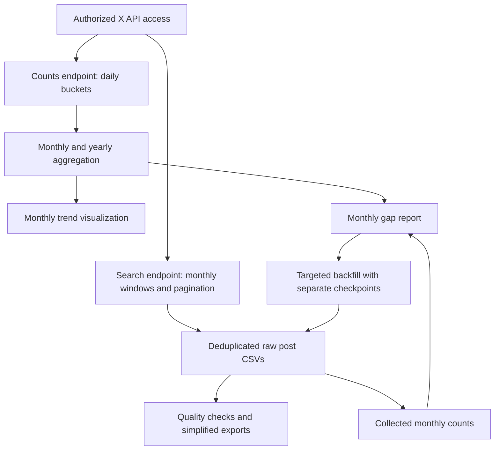

# Cancel Culture Research with the X API

**Python automation, REST API integration, and reproducible data preparation for academic research.**

This portfolio documents my technical work as an Undergraduate Research Assistant at the **UBC Sauder School of Business**, supervised by **Professor Jen Park**. The research examines cancellation and boycotting language on X through two complementary workflows: historical hashtag counts and a collection of individual posts from 2022.

The repository presents the implementation and an offline synthetic demonstration. Research datasets, unpublished findings, and original figures are withheld. The research role and supervision are supplied by the project owner; the technical capabilities below were checked against the existing source files. This is a portfolio of my research support work, not a claim to sole authorship of the broader study.

## Research scope

| Workflow | Research interval (UTC) | What it produces |
|---|---|---|
| Historical trends | January 2015–December 2025 | Daily API count buckets, monthly/yearly aggregates, and a monthly comparison plot |
| Post collection | January–December 2022 | Post-level CSVs, simplified research exports, quality checks, and collection-gap reports |

Both primary workflows use the exact queries `#cancel -is:retweet lang:en` and `#boycott -is:retweet lang:en`. These match hashtags in English posts and exclude retweets. They do not establish that every match concerns cancel culture. Replies and quote posts are not explicitly excluded. Broader phrase searches and causal or inferential statistical results are not claimed.

## Technical contributions

- Automated full-archive requests with monthly time windows, pagination, structured CSV exports, and post-ID deduplication.
- Supported restartable collection with atomic checkpoint replacement, retry logs, exponential backoff, and waits informed by rate-limit headers.
- Built gap-driven backfill with monthly, daily, hourly, 15-minute, and 5-minute windows, plus count-guided window selection.
- Prepared research exports with full-text fallback, timestamp ordering, and engagement fields; checked duplicates, missing fields, and year boundaries.
- Aggregated historical count buckets and visualized monthly hashtag frequencies with pandas and Matplotlib.

These are practical data engineering and automation patterns: explicit schemas, restart state, observable failures, and separated collection and transformation stages. No cloud deployment, distributed infrastructure, or production service is claimed. [Contribution evidence and attribution](docs/technical_contributions.md) distinguishes original functionality from portfolio preparation.

## Architecture



The counts workflow uses `GET /2/tweets/counts/all`; the post workflow uses `GET /2/tweets/search/all`. A count bucket represents matching posts reported by the API, **not individually retrieved records**. The two workflows have different reliability implementations: the historical notebook uses a fixed wait on HTTP 429; the 2022 collector implements bounded retries and checkpoint recovery.

## Run the offline demonstration

Requires Python **3.10 or newer**. Run commands from the repository root.

```bash
python3 -m venv .venv
source .venv/bin/activate
python -m pip install -r requirements.txt
python -m src.demo
python -m unittest discover -s tests -v
```

The demonstration uses invented text and nonnumeric synthetic IDs. It opens no network connections and writes only to a newly created temporary directory. For each hashtag it attempts four rows, suppresses one repeated ID, and produces three unique rows plus export, quality, monthly-count, and gap files. **Those numbers are demonstration outputs, not research findings.**

## Authorized research usage

CLI entry points provide `--help` without making API requests:

```bash
python -m src.api_collection.historical_counts --help
python -m src.api_collection.collect_x_posts_2022 --help
python -m src.api_collection.backfill_x_posts_2022 --help
```

Live collection requires credentials, account access, spending authorization, and an explicit `--allow-live-api` flag. No live request was used to prepare or validate this portfolio. See [usage](docs/usage.md) for input paths, offline processing, and backfill planning. Current access and billing must be checked with X before execution; old notebook cost estimates were removed.

## Verified implementation and result availability

The original workspace contains count tables, collected post files, derived exports, quality/gap reports, and a saved monthly trend figure. The audit also found differing versions of historical count tables and stale status reports. These remain unresolved provenance issues; this repository publishes no numerical research findings or original visualizations. The detailed reconciliation and figure inventory are retained outside Git in a local-only audit.

The original monthly plotting code is available in [monthly_trends.py](src/visualization/monthly_trends.py). It uses an outer join and fills missing values with zero; missing data therefore need review before interpretation. [Results policy](results/README.md) explains what is withheld.

## Engineering challenges and limitations

| Challenge | Implemented approach | Remaining limitation |
|---|---|---|
| Large paginated searches | Time windows, `next_token`, up to 500 results per request | Access and limits depend on the account; exhausted pagination does not prove complete coverage |
| Interrupted collection | Page-level checkpoints and deduplication against existing CSV IDs | CSV append and checkpoint update are not a single transaction; no concurrent-writer locking |
| Temporary API failures | Bounded retries and header-based waits in the 2022 collector | Historical counts have simpler retry handling and no checkpoint recovery |
| Count/search discrepancies | Monthly gap reports and smaller backfill windows | API counts are a reference, not a guaranteed recoverable population |
| Reproducibility | Explicit schemas, documented provenance, synthetic offline tests | Restricted research data and unsettled source versions prevent full result reproduction here |

## Repository structure

```text
cancel-culture-x-api-analysis/
├── README.md, requirements.txt, .env.example, .gitignore
├── RELEASE_FILES.txt          # Explicit staging allowlist
├── docs/                      # Scope, methodology, schemas, provenance, usage, security
├── src/
│   ├── config.py, demo.py
│   ├── api_collection/        # Counts, 2022 collection/backfill, historical pilot
│   ├── preprocessing/         # Simplified research exports
│   ├── analysis/              # Aggregation, quality checks, collection gaps
│   └── visualization/         # Monthly time-series plotting
├── notebooks/                # Sanitized source; original outputs removed
├── data/sample/               # Clearly labeled synthetic fixtures
├── results/README.md          # Research-output availability
├── reports/README.md          # Restricted-report availability
├── tests/                     # Offline tests with synthetic responses
└── tools/check_release.py     # Staged-file review checks
```

## Data availability and confidentiality

No raw posts, user identifiers, real post text, labeled datasets, original reports, credentials, or research results belong in this repository. Synthetic examples do not reproduce source records. The separate Reddit research project is outside scope. Files are staged with an explicit allowlist as well as `.gitignore` protections.

External storage is subject to project-specific ownership and sharing permission, even for a private repository. No reuse license is asserted while ownership is unresolved. See [data handling and policy references](docs/security_and_sharing.md), [data dictionary](docs/data_dictionary.md), [methodology](docs/methodology.md), and [source provenance](docs/source_provenance.md).
