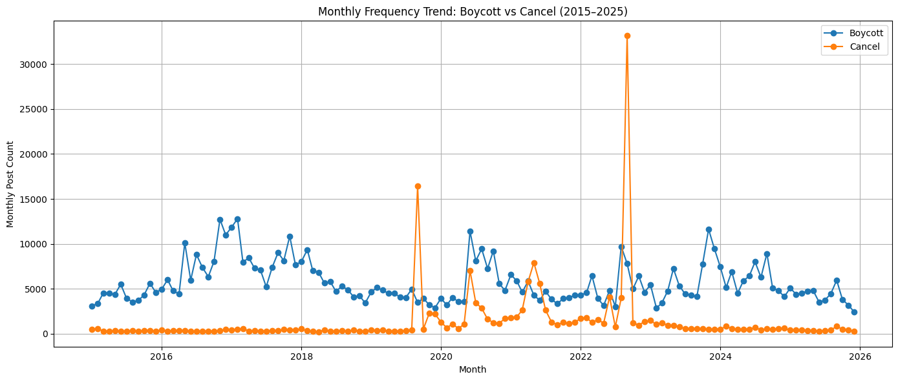

# How #cancel and #boycott activity differed on X

**Junseok Park · Undergraduate Research Assistant, UBC Sauder School of Business**

## Question

How did the frequency and timing of `#cancel` and `#boycott` differ from January 2015 through December 2025? I used a second, post-level workflow to assess the quality of the files available for a closer look at 2022.

## Method

I used the X API full-archive Counts endpoint to obtain daily buckets for the exact hashtag queries `#cancel -is:retweet lang:en` and `#boycott -is:retweet lang:en`, then aggregated counts by month and year in Python. The comparison below uses the two archived monthly tables that fed the original chart. Each contains 132 consecutive UTC months. The separate daily-derived version has different values, so I kept the chart inputs together and used them consistently for the comparisons below. [Data provenance](../data/README.md)

## What I found

| Series | Total matches | Peak month | Peak count | Peak share of series total |
|---|---:|---|---:|---:|
| `#cancel` | 173,985 | Sep 2022 | 33,147 | 19.1% |
| `#boycott` | 753,216 | Feb 2017 | 12,794 | 1.7% |

`#boycott` had higher counts in 128 of 132 months and recurring peaks across the period. `#cancel` was generally lower but rose sharply in late 2019 and 2022. Its largest month alone accounted for nearly one fifth of its total across the period.

## What the results suggest

The `#boycott` matches were more sustained over time, while the largest `#cancel` spike contributed a much larger share of its series. For follow-up research, that difference suggests comparing spike months with quieter months before choosing examples for close reading. The two query totals are reported separately because a post can match both hashtags.

The 2022 collection provides a starting point for that follow-up. Validation found 51,059 distinct IDs in the saved `#cancel` file and 55,218 in the `#boycott` file, with 137 shared IDs and no within-file duplicates. These checks describe the saved files. [2022 collection audit](../data/summary/2022_collection_file_audit.csv)

## Limits and reproducibility

Exact hashtags capture one way people use these terms. The counts do not measure all relevant discussion, establish why a spike occurred, or measure offline behavior. Platform activity and coverage can change over time. The 2022 post files and the historical Counts API series measure different things, and the file audit does not establish how many matching posts were missed. The original chart can be regenerated offline from the released inputs. [Reproduction instructions](../results/README.md)
